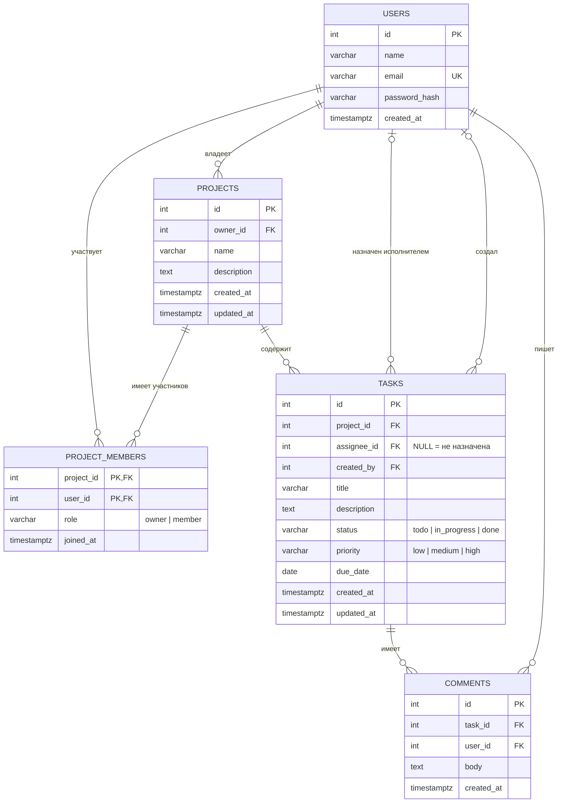

# ER-диаграмма: Task & Project Management

## Связи

| Связь | Тип | Как реализована |
|---|---|---|
| users → projects (владелец) | 1:N | `projects.owner_id` |
| users ↔ projects (участники) | M:N | таблица-связка `project_members`, составной PK `(project_id, user_id)` |
| projects → tasks | 1:N | `tasks.project_id` |
| users → tasks (исполнитель) | 0..1:N | `tasks.assignee_id`, может быть NULL |
| users → tasks (автор) | 0..1:N | `tasks.created_by` |
| tasks → comments | 1:N | `comments.task_id` |
| users → comments | 1:N | `comments.user_id` |

## Что происходит при удалении

| Внешний ключ | ON DELETE | Почему |
|---|---|---|
| `projects.owner_id` | CASCADE | пользователь удалил аккаунт, его проекты уходят вместе с ним |
| `project_members.*` | CASCADE | членство не имеет смысла без проекта или пользователя |
| `tasks.project_id` | CASCADE | задачи живут только внутри проекта |
| `tasks.assignee_id` | SET NULL | задача остаётся, просто становится не назначенной |
| `tasks.created_by` | SET NULL | история задачи не теряется |
| `comments.task_id` | CASCADE | комментарии принадлежат задаче |
| `comments.user_id` | CASCADE | можно заменить на SET NULL и показывать «удалённый пользователь» |

## Решения, которые стоит уметь объяснить на viva

- **3НФ.** У каждой таблицы один смысл, повторяющихся данных нет: имя пользователя хранится только в `users`, а в задачах и комментариях лежит лишь его `id`.
- **Зачем `project_members`.** Один пользователь в нескольких проектах, в одном проекте несколько пользователей: это M:N, а в реляционной БД она решается таблицей-связкой.
- **`owner_id` и роль `owner` одновременно.** `owner_id` даёт быстрый ответ «кто создатель», а роль в `project_members` упрощает проверку доступа одним запросом. Можно оставить что-то одно, но тогда продумай проверку прав.
- **`status` и `priority`.** Допустимые значения ограничены через `CHECK (status IN (...))`, а не `ENUM`: CHECK проще менять в миграциях.
- **`password_hash`, а не `password`.** Пароль хранится только в виде хеша bcrypt (требование брифа).
- **Индексы.** PK и UNIQUE индексируются автоматически. Внешние ключи в PostgreSQL автоматически не индексируются, поэтому добавлены индексы на `tasks.project_id`, `tasks.assignee_id`, `comments.task_id`, `project_members.user_id`.

## Реализация

Схема реализована миграциями `db/migrations/001–005` (порядок users → projects → project_members → tasks → comments), полная склейка лежит в `db/schema.sql`.
